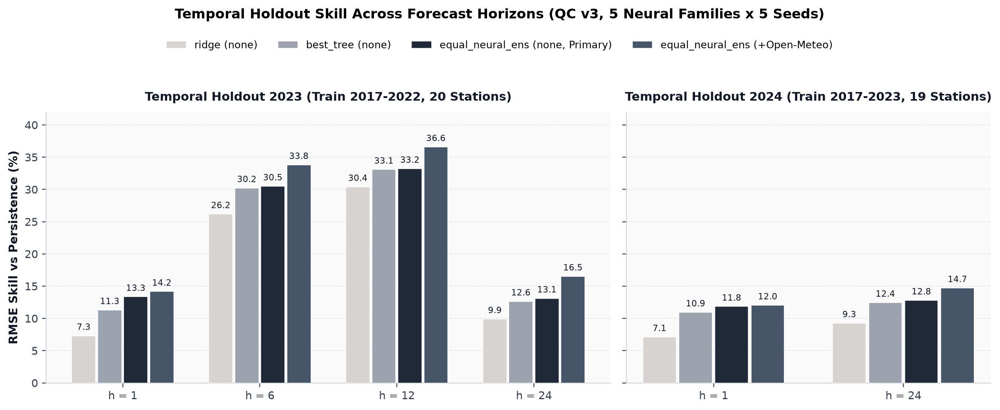
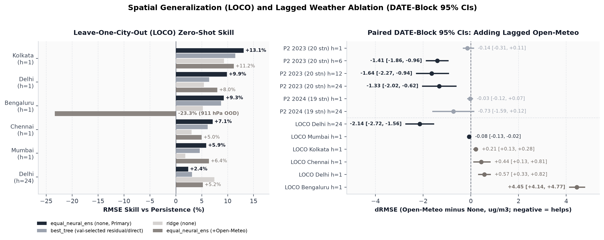
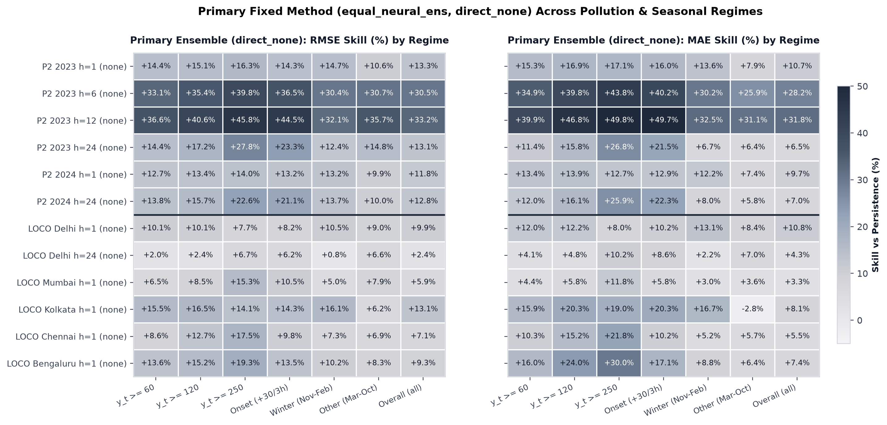

# Hourly PM₂.₅ Forecasting Across Indian Cities (2017–2024)


Leak-free multi-horizon (`h = 1, 6, 12, 24` hours) and leave-one-city-out (LOCO) hourly **PM₂.₅ (µg/m³)** forecasting benchmark across **20 continuous monitoring stations** in five Indian megacities (`Bengaluru`, `Chennai`, `Delhi`, `Kolkata`, `Mumbai`; 2017–2024 IST), evaluated with calendar **DATE-block paired bootstrap 95% confidence intervals** (`B = 1,000` resamples, no p-values).

> **Fixed Primary Method (chosen in advance):** Equal-weight 5-family × 5-seed neural ensemble (`gru`, `lstm`, `bilstm`, `tcn`, `cnn_lstm`; `direct` target; **no exogenous weather**, `direct_none`), trained with train-only scaling, strict `h + 24` temporal purge gaps, and frozen QC v3.

---

## Key Findings

1. **Temporal Forecasting Skill Across Horizons (`P2_2023` & `P2_2024`):**
   - Under no-weather `direct_none`, `equal_neural_ens` achieves **`+13.35%`** (`h=1`), **`+30.49%`** (`h=6`), **`+33.22%`** (`h=12`), and **`+13.10%`** (`h=24`) RMSE skill vs persistence in `P2_2023`, and **`+11.84%`** (`h=1`) / **`+12.80%`** (`h=24`) in `P2_2024` (`19` stations with 2024 data; `Mumbai/BKC` had 0 valid hours in 2024).
   - At `h = 6` and `h = 12`, `equal_neural_ens` strongly beats both diurnal `same_hour_yesterday` (`dRMSE = -8.93 [-10.49, -7.43]` at `h=6`; `-6.07 [-7.43, -4.78]` at `h=12`) and persistence.

2. **Lagged ERA5 Weather Helps Under Temporal Holdout & Long-Range Delhi, Hurts Unseen-City `h=1` LOCO:**
   - Adding causal (`<= t`) Open-Meteo ERA5 weather with the exact same 5 neural families significantly lowers RMSE at medium/long temporal horizons in `P2_2023` (`h=6`: **`-1.41 [-1.86, -0.96]`**; `h=12`: **`-1.64 [-2.27, -0.94]`**; `h=24`: **`-1.33 [-2.02, -0.62]`**) and unseen-city `Delhi h=24` (**`-2.14 [-2.72, -1.56]`**).
   - At `h = 1` LOCO, Open-Meteo degrades skill in 4 of 5 held-out cities, most sharply in **Bengaluru (`-23.31%`, `dRMSE = +4.45 [+4.14, +4.77]`)** because Bengaluru sits at ~920 m elevation (`surface_pressure` `902.6–920.9 hPa` vs `964.5–1021.1 hPa` across the 4 training cities), pushing train-standardized pressure out of distribution.

3. **Unseen-City Level Shift Breaks Direct Trees & Naive Validation Stacks:**
   - Direct tree models (`gbm_direct` `-45.13%`, `xgb_direct` `-42.83%` on `Delhi h=1`) fail to extrapolate beyond the non-Delhi training PM₂.₅ range; residual-target trees (`y_{t+h} - y_t`) recover positive skill (`+6.43%` / `+7.44%`).
   - Across `h=1` LOCO (`direct_none`), `equal_neural_ens` achieves `+5.88%` (`Mumbai`) to `+13.08%` (`Kolkata`) and reliably outperforms or matches NNLS stacking without validation-weight overfitting under domain shift.

---

## Visual Summary

### Temporal Holdout Performance (`P2_2023` & `P2_2024`)


### Leave-One-City-Out Generalization & Lagged Open-Meteo DATE-Block 95% CIs


### Primary Method (`equal_neural_ens`, `direct_none`) Across Pollution & Seasonal Regimes


---

## Study Design & Zero-Leakage Protocol

### Dataset & Station Scope (20 Study Stations)
- **Source:** Official 15-minute CPCB archive Parquets from [Vonter/india-cpcb-aqi](https://github.com/Vonter/india-cpcb-aqi) (`2017–2024`), averaged hourly on IST wall-clock timestamps after dropping negatives and nulls.
- **Included Cities (4 stations each = 20 stations):**
  - **Bengaluru:** BTM Layout, Hebbal, Hombegowda Nagar, Peenya
  - **Chennai:** Kodungaiyur, Manali CPCB, Perungudi, Royapuram
  - **Delhi:** Anand Vihar, Mandir Marg, Punjabi Bagh, R.K. Puram
  - **Kolkata:** Ballygunge, Jadavpur, Rabindra Bharati, Victoria
  - **Mumbai:** BKC *(train/val only in P2_2024; 0 valid hours in 2024)*, Borivali East, Powai, Sion MPCB
- **Excluded:** Hyderabad (4 stations excluded prior to final study due to ~87 µg/m³ sensor ceilings on 3/4 stations).

### Frozen QC v3 Rules (`qc.qc_station_v3`)
Applied identically per station before windowing:
1. Flag exact/near sensor fault plateaus `{985.0, 999.99}` (±0.01) **plus a ±3-hour halo** around every fault run as `NaN`.
2. Enforce physical bounds `[0, 980]` µg/m³.
3. Remove stuck runs `> 6h` (any value) and `>= 3h` for elevated values `> 200` µg/m³.
4. Remove 1-hour neighbor-ratio spikes (`>= 200` with neighbor ratio `>= 3.0`, or `> 500` next to `NaN` with ratio `>= 5.0`) and 1–2 hour rolling-median spikes (`> 200`, `> 4×` ±6h median excluding the run, both flanks `< 0.25×` run min).
5. Linearly interpolate interior gaps `<= 6h`; target windows strictly require valid non-interpolated ground-truth `y_{t+h}` and 24 finite contiguous lookback hours `[t-23 .. t]`.

### Experimental & Statistical Protocol
- **Hyperparameters (fixed across all 24 runs):** `LOOKBACK = 24`, `HIDDEN = 64`, `EPOCHS = 60`, `PATIENCE = 7`, `BATCH = 2048`, `LR = 1e-3`, `SEEDS = [0, 1, 2, 3, 4]`.
- **Splits & Purge Gaps:**
  - `P2_2023`: Train/val `2017–2022` (last 10% per station = val), test `2023`, `h + 24` purge gaps before val and before `2023-01-01`.
  - `P2_2024`: Train/val `2017–2023` (20 stations incl. BKC), test `2024` (19 stations excl. BKC), `h + 24` purge gaps before val and before `2024-01-01`.
  - `P1_LOCO`: Train/val on 4 cities (`h + 24` purge before each station's final 10% val slice), zero-shot test on the held-out city (`2017–2023`).
- **Exogenous Weather (Ablation):** Co-located Open-Meteo ERA5 hourly variables (`temperature_2m`, `relative_humidity_2m`, `wind_speed_10m`, `wind_direction_10m` as sin/cos, `surface_pressure`, `shortwave_radiation`, `precipitation`, `boundary_layer_height`) strictly at `<= t`. Note: upstream Open-Meteo returned `NaN` for `boundary_layer_height` during `2024-01-01 05:00 .. 2024-07-01 04:00` (`4,368`h/city), standardized to `0.0` (2017–2023 training mean).
- **DATE-Block Paired Bootstrap:** Resamples whole calendar dates (`all stations on date d in the same block`), `1,000` multinomial resamples, `95%` percentile CIs, **no p-values**.
- **Regimes (`time-t` defined only):** `y_t >= 60`, `y_t >= 120`, `y_t >= 250` µg/m³ (CPCB categories), rapid onset (`y_t - y_{t-3} > 30`), winter (`Nov–Feb`), other months (`Mar–Oct`), keeping negative skill values unclipped.

---

## Headline Results (`results_final/`)

| Run | `N_test` | Date Blks | Persist RMSE | `equal_neural_ens` RMSE (Skill) | Best Val Tree (`choice`) | Stack Ablation (Skill) |
| --- | ---: | ---: | ---: | --- | --- | --- |
| `P2_2023` `h=1` (`none`, **Primary**) | 151,279 | 365 | 16.836 | **14.588 (+13.35%)** | 14.933 (+11.30%, `gbm_residual`) | 14.562 (+13.51%) |
| `P2_2023` `h=1` (`openmeteo`) | 151,279 | 365 | 16.836 | 14.452 (+14.16%) | 14.752 (+12.37%, `xgb_residual`) | 14.517 (+13.77%) |
| `P2_2023` `h=6` (`none`, **Primary**) | 149,831 | 365 | 42.552 | **29.576 (+30.49%)** | 29.692 (+30.22%, `xgb_direct`) | 29.369 (+30.98%) |
| `P2_2023` `h=6` (`openmeteo`) | 149,831 | 365 | 42.552 | 28.165 (+33.81%) | 28.849 (+32.20%, `gbm_direct`) | 27.952 (+34.31%) |
| `P2_2023` `h=12` (`none`, **Primary**) | 148,395 | 365 | 48.621 | **32.468 (+33.22%)** | 32.538 (+33.08%, `xgb_direct`) | 32.341 (+33.48%) |
| `P2_2023` `h=12` (`openmeteo`) | 148,395 | 365 | 48.621 | 30.835 (+36.58%) | 31.543 (+35.13%, `gbm_direct`) | 30.642 (+36.98%) |
| `P2_2023` `h=24` (`none`, **Primary**) | 146,751 | 365 | 38.837 | **33.747 (+13.10%)** | 33.927 (+12.64%, `xgb_direct`) | 33.934 (+12.62%) |
| `P2_2023` `h=24` (`openmeteo`) | 146,751 | 365 | 38.837 | 32.422 (+16.52%) | 33.301 (+14.25%, `gbm_direct`) | 32.614 (+16.02%) |
| `P2_2024` `h=1` (`none`, **Primary**) | 146,669 | 366 | 15.542 | **13.702 (+11.84%)** | 13.842 (+10.94%, `xgb_residual`) | 13.695 (+11.89%) |
| `P2_2024` `h=1` (`openmeteo`) | 146,669 | 366 | 15.542 | 13.673 (+12.03%) | 13.880 (+10.70%, `xgb_residual`) | 13.691 (+11.91%) |
| `P2_2024` `h=24` (`none`, **Primary**) | 142,882 | 366 | 38.166 | **33.279 (+12.80%)** | 33.413 (+12.45%, `xgb_direct`) | 33.278 (+12.81%) |
| `P2_2024` `h=24` (`openmeteo`) | 142,882 | 366 | 38.166 | 32.551 (+14.71%) | 32.610 (+14.56%, `xgb_direct`) | 32.222 (+15.57%) |
| `LOCO Delhi` `h=1` (`none`, **Primary**) | 208,048 | 2,524 | 30.616 | **27.593 (+9.87%)** | 28.648 (+6.43%, `gbm_residual`) | 27.853 (+9.03%) |
| `LOCO Delhi` `h=1` (`openmeteo`) | 208,048 | 2,524 | 30.616 | 28.161 (+8.02%) | 29.575 (+3.40%, `gbm_residual`) | 27.577 (+9.93%) |
| `LOCO Delhi` `h=24` (`none`, **Primary**) | 201,649 | 2,516 | 75.540 | **73.736 (+2.39%)** | 73.169 (+3.14%, `xgb_direct`) | 73.722 (+2.41%) |
| `LOCO Delhi` `h=24` (`openmeteo`) | 201,649 | 2,516 | 75.540 | 71.595 (+5.22%) | 75.317 (+0.29%, `xgb_direct`) | 73.018 (+3.34%) |
| `LOCO Mumbai` `h=1` (`none`, **Primary**) | 124,425 | 1,671 | 14.168 | **13.335 (+5.88%)** | 13.512 (+4.63%, `xgb_residual`) | 13.348 (+5.79%) |
| `LOCO Mumbai` `h=1` (`openmeteo`) | 124,425 | 1,671 | 14.168 | 13.261 (+6.40%) | 13.282 (+6.25%, `xgb_residual`) | 13.298 (+6.14%) |
| `LOCO Kolkata` `h=1` (`none`, **Primary**) | 155,533 | 2,030 | 10.982 | **9.545 (+13.08%)** | 9.723 (+11.46%, `xgb_residual`) | 9.535 (+13.17%) |
| `LOCO Kolkata` `h=1` (`openmeteo`) | 155,533 | 2,030 | 10.982 | 9.754 (+11.18%) | 10.278 (+6.41%, `xgb_residual`) | 9.714 (+11.55%) |
| `LOCO Chennai` `h=1` (`none`, **Primary**) | 118,085 | 2,407 | 20.754 | **19.280 (+7.10%)** | 19.477 (+6.15%, `xgb_residual`) | 19.165 (+7.65%) |
| `LOCO Chennai` `h=1` (`openmeteo`) | 118,085 | 2,407 | 20.754 | 19.718 (+4.99%) | 19.466 (+6.20%, `xgb_residual`) | 19.603 (+5.55%) |
| `LOCO Bengaluru` `h=1` (`none`, **Primary**) | 168,738 | 2,433 | 13.624 | **12.362 (+9.27%)** | 12.437 (+8.71%, `xgb_residual`) | 12.338 (+9.44%) |
| `LOCO Bengaluru` `h=1` (`openmeteo`) | 168,738 | 2,433 | 13.624 | 16.800 (-23.31%) | 12.516 (+8.14%, `xgb_residual`) | 14.394 (-5.65%) |

Full CSV outputs (all baselines, per-family 5-seed means/stds, all DATE-block CIs, and all regime breakdowns) are included directly under [`spm_pipeline/results_final/`](spm_pipeline/results_final/).

---

## Repository Structure

```text
.
├── README.md
├── assets/                          # Neutral-palette summary figures
└── spm_pipeline/
    ├── config.py                    # Frozen hyperparameters & thresholds
    ├── qc.py                        # QC v1, v2, and frozen QC v3 implementations
    ├── data.py, models.py, evaluate.py
    ├── final_study.py               # Main 24-run benchmark runner -> results_final/
    ├── final_report.py              # Table & markdown report compiler
    ├── make_readme_figures.py       # Chart generator for README figures
    ├── fetch/
    │   ├── download_cpcb.py         # Sparse Parquet Range fetcher (Vonter releases)
    │   ├── export_opencity.py       # 15-min -> hourly IST OpenCity matrix exporter
    │   ├── ingest_2024.py           # 2024 CPCB + Open-Meteo ingest & QC v3 cache builder
    │   └── study20_stations.json    # Canonical 20-station manifest (5 cities)
    ├── sweep/
    │   ├── models_sweep.py          # Ridge, LGBM, CUDA XGBoost, GRU, LSTM, BiLSTM, TCN, CNN-LSTM
    │   ├── splits.py                # Feature extraction, scaling & weather alignment
    │   └── weather_prep.py          # Open-Meteo ERA5 & CPCB weather preparation
    ├── tests/
    │   ├── test_pipeline.py
    │   ├── test_sweep.py
    │   └── test_final.py
    └── results_final/               # Committed CSV tables & FINAL_REPORT.md
```

---

## Reproduction

```bash
# 1. Install dependencies
pip install numpy pandas scipy scikit-learn torch lightgbm xgboost pyarrow requests matplotlib

# 2. Verify unit tests
cd spm_pipeline
python tests/test_pipeline.py
python tests/test_sweep.py
python tests/test_final.py

# 3. Fetch raw CPCB (2017-2024) & Open-Meteo ERA5 weather, then build QC v3 caches
python fetch/download_cpcb.py --start 2017 --end 2024
python sweep/weather_prep.py
python fetch/ingest_2024.py

# 4. Run final 24-config benchmark & compile summary tables
python final_study.py --phase 0 --out results_final
python final_report.py
```

---

## Data Attribution & License Note

Air quality measurements originate from the Central Pollution Control Board (CPCB, India) public monitoring network redistributed as annual Parquet archives via [Vonter/india-cpcb-aqi](https://github.com/Vonter/india-cpcb-aqi). Reanalysis meteorology (`weather_openmeteo`) is sourced from the [Open-Meteo Historical Weather API](https://open-meteo.com/en/docs/historical-weather-api) (ERA5).
